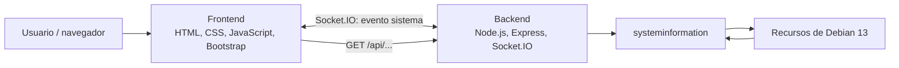

# Monitor de Recursos

## Trabajo Práctico Final Integrador

Aplicación cliente-servidor para monitorear los recursos de una máquina virtual Debian 13 en tiempo real.

## Integrantes
- Estudiante A: Carolina García.
- Estudiante B: Giselle Vazquez.

## Descripción del proyecto
-El proyecto busca facilitar el monitoreo del estado de un servidor, sin la necesidad de tener que ejecutar manualmente un comando diferente para consultar cada recurso. El usuario puede ver el uso del procesador, la memoria RAM y SWAP, el almacenamiento, la red y la información del sistema operativo.
El backend obtiene las métricas del servidor donde se esta ejecutando. El frontend las presenta en tarjetas y recibe actualizaciones automáticas cada 2 segundos mientras el servidor y el cliente están conectados. Esto permite observar los cambios sin recargar la página.

## Ramas de trabajo
- main: versión principal del proyecto.
- rama-backend: desarrollo del backend.
- rama-frontend: desarrollo del frontend.
  
## Tecnologías
#Frontend:
-  HTML: Estructura de las seis tarjetas del monitor; CSS: Colores, tipografía, bordes y espaciado; JavaScript: Manipulación del DOM, funciones, arreglos, objetos, condicionales y ciclos; Bootstrap 5: Diseño adaptable, tarjetas, alertas y barras de progreso.
#Backend: Node.js: Ejecución del backend en Debian; pnpm: Instalación y administración de dependencias; Express:Servidor HTTP, archivos estáticos y rutas REST; Socket.IO: Envío periódico de métricas al navegador y detección de conexión; cors:Configuración del acceso entre orígenes; y systeminformation: Consulta de CPU, RAM, SWAP, discos, red y sistema operativo.
- Control de versiones: Git y GitHub: Versionado, ramas, colaboración e integración del código.
- Sistema operativo: Debian 13 es entorno de ejecución 
- VirtualBox: Pruebas en máquina virtual.
- Visual Studio Code / Remote-SSH: Edición del proyecto en la máquina Debian.
 
## Funcionalidades
- Monitoreo de CPU y memoria RAM.
- Información sobre discos, red y sistema operativo.
- API HTTP que devuelve información en formato JSON.
- Actualización en tiempo real mediante Socket.IO.
- Interfaz web adaptable a dispositivos móviles.

## Arquitectura del proyecto

El frontend muestra los datos e interpreta los eventos recibidos. El backend consulta los recursos del sistema, responde solicitudes HTTP y emite actualizaciones con Socket.IO.

El servidor Express publica la carpeta `frontend/public`, de modo que la interfaz y Socket.IO funcionan desde el mismo origen HTTP en la integración probada.

## Estructura real del repositorio

monitor-recursos/
├── backend/
│   ├── .gitignore
│   ├── package.json
│   ├── pnpm-lock.yaml
│   └── server.js
├── frontend/
│   └── public/
│       ├── css/
│       │   └── estilos.css
│       ├── js/
│       │   └── app.js
│       └── index.html
├── docs/
├── mobile/
├── .gitignore
└── README.md

- backend/server.js: recolección de métricas, rutas REST y eventos Socket.IO.
- backend/package.json: dependencias y comando para iniciar Node.js.
- backend/pnpm-lock.yaml: versiones utilizadas por pnpm.
- frontend/public/index.html: tarjetas y elementos de la interfaz.
- frontend/public/css/estilos.css: personalización visual.
- frontend/public/js/app.js: funciones para actualizar textos, barras y estado de conexión.
- docs/: espacio reservado para documentación, diagramas y evidencias.
- mobile/: espacio reservado para la aplicación móvil.

## Requisitos previos

Para reproducir el entorno probado:

- Debian 13.
- Node.js instalado (en el entorno de desarrollo se utilizó Node.js 24.22.2).
- pnpm instalado (versión utilizada: 12.18.0).
- Git.
- Un navegador con JavaScript habilitado.
- Conectividad de red para instalar las dependencias la primera vez.

En las pruebas se utilizó VirtualBox y Visual Studio Code con Remote-SSH. No son obligatorios si ya se dispone de un equipo Debian compatible.

## Instalación

Desde una terminal de Debian:

bash
git clone https://github.com/vazgiselle8-sys/monitor-recursos.git
cd monitor-recursos

# Utilizar la versión que se integró y probó
git switch --track origin/integracion-pruebas

cd backend
pnpm install --frozen-lockfile

La instalación se verificó con el archivo `pnpm-lock.yaml` y las dependencias registradas en `package.json`.

## Configuración

El servidor está configurado en backend/server.js con estos valores:

- Puerto HTTP: 3000
- Dirección de escucha: 0.0.0.0
- Intervalo de emisión: 2000 ms
- Evento de métricas: sistema
- Evento de error de lectura: error-monitor
- Origen del frontend integrado:  Servido por Express desde frontend/public

En el código revisado se permite CORS para las conexiones del servidor. Para un despliegue fuera del laboratorio sería conveniente restringir los orígenes permitidos y revisar las reglas de firewall.

## Ejecución del proyecto

Desde la carpeta backend:

#bash
pnpm start

- El comando ejecuta "node server.js". Si inicia correctamente, el servidor informa que está escuchando en el puerto 3000.
- Abrir desde el equipo propio:   http://localhost:3000
- Desde otra computadora, utilizar "http://IP_DEL_SERVIDOR:3000" si existe conectividad y el puerto está permitido. En las pruebas, el backend se ejecutó en la VM Debian llamada "AUDITORIA"; las métricas corresponden a **esa máquina**, no a la computadora del navegador.
- Para detener manualmente el servidor iniciado desde la terminal, presionar "Ctrl + C".

## Funcionamiento general

1. El usuario abre el monitor desde un navegador.
2. Express entrega "index.html", los estilos CSS y "app.js".
3. El frontend inicia la conexión con Socket.IO mediante "io()".
4. El servidor registra al cliente y obtiene las métricas con "systeminformation".
5. El backend envía un primer objeto JSON con el evento "sistema".
6. El frontend recibe ese objeto y actualiza las seis tarjetas.
7. El backend emite nuevas métricas cada 2 segundos mientras haya usuarios conectados.
8. Si se pierde la conexión, el indicador cambia de estado; al restablecerse, vuelven las actualizaciones.

## API REST

El backend permite consultar los recursos también mediante HTTP, independientemente del panel en tiempo real.

| Método | Ruta         | Información                             |
|--------|--------------|-----------------------------------------|
| GET    | /api/sistema | Todas las métricas reunidas en un JSON. |
| GET    | /api/so      | Distribución, versión, kernel, arquitectura y uptime. |
| GET    | /api/cpu     | Modelo, núcleos, velocidad, uso y temperatura si está disponible. |
| GET    | /api/memoria | RAM y SWAP. |
| GET    | /api/discos  | Arreglo de particiones y capacidades. |
| GET    | /api/red     | Interfaz principal, IP, MAC y velocidad. |

Ejemplo de consulta:   http://localhost:3000/api/sistem

La respuesta principal incluye sistema, cpu, memoria, discos y red. El navegador puede mostrar el JSON directamente, sin instalar herramientas adicionales.

## Comunicación en tiempo real con Socket.IO

HTTP tradicional funciona mediante solicitudes y respuestas. En cambio, Socket.IO mantiene una comunicación orientada a eventos que permite que el servidor envíe actualizaciones al cliente sin que este tenga que solicitar cada lectura por separado.
Esto es útil para el monitor porque los recursos cambian continuamente y el navegador debe reflejar esos cambios sin recargar la página.
La comunicación es bidireccional: cliente y servidor pueden emitir y escuchar eventos.  En la versión actual del monitor, los datos de recursos se envían principalmente del servidor al navegador.

## Eventos utilizados

| Evento        | Quién lo produce           | Quién lo atiende | Función real |
|---------------|----------------------------|------------------|--------------|
| connection    | Socket.IO al ingresar un cliente | Backend | Registrar una nueva conexión. |
| connect       | Socket.IO al completar la conexión | Frontend | Cambiar el indicador a verde. |
| sistema       | Backend         | Frontend | Enviar el objeto JSON de métricas. |
| error-monitor | Backend         | Evento disponible para el cliente | Informar fallos de lectura; la interfaz actual no muestra un tratamiento específico de este evento. |
| disconnect    | Socket.IO       | Backend y frontend | Registrar y mostrar la desconexión. |
| connect_error | Socket.IO cuando falla la conexión | Frontend | Mostrar error de conexión en rojo. |

## Comunicación frontend → backend

- Al ejecutar "io()" en "app.js", el navegador solicita establecer una conexión Socket.IO con el servidor. El backend recibe esta conexión mediante "io.on("connection", ...)".
- El navegador también puede solicitar datos al backend mediante una petición HTTP "GET", por ejemplo al abrir "/api/sistema".

## Comunicación backend → frontend

- El servidor envía las métricas a un cliente al conectarse:

javascript
socket.emit("sistema", datos);

- Además, envía actualizaciones a los clientes conectados:

javascript
io.emit("sistema", datos);

- El frontend escucha el mismo evento:

javascript
socket.on("sistema", function (datos) {
    mostrarCPU(datos.cpu);
    mostrarRAM(datos.memoria);
    mostrarSWAP(datos.memoria);
    mostrarDiscos(datos.discos);
    mostrarRed(datos.red);
    mostrarSistemaOperativo(datos.sistema);
});

- Las funciones actualizan los textos y las barras utilizando el DOM. RAM y SWAP comparten el objeto "datos.memoria".

## Identificación de conexiones con "socket.id"

Cuando un navegador establece conexión, Socket.IO le asigna un identificador de conexión, disponible como "socket.id". El servidor lo muestra en la consola mediante:

Javascript
console.log("Cliente conectado: " + socket.id);

Ese identificador permite distinguir conexiones activas, pero **no representa una cuenta ni una autenticación de usuario**. Puede cambiar después de desconectarse y volver a conectarse. Este monitor no implementa registro ni inicio de sesión.

## Desconexión y reconexión

El frontend escucha los eventos "disconnect" y "connect_error" para mostrar el estado del servidor. Si el backend se detiene, el indicador pasa de verde a rojo. Cuando Node.js vuelve a iniciar, Socket.IO puede restablecer la conexión y reanudar las actualizaciones.
En la prueba realizada se detuvo Node.js con "Ctrl + C" y se volvió a iniciar con "pnpm start", **sin recargar la página**. Se observaron la pérdida de conexión, el error de conexión y la posterior reconexión.
Los valores de las tarjetas permanecen visibles durante una desconexión, pero son los **últimos datos recibidos** y no deben interpretarse como mediciones actualizadas.

## Capturas de pantalla

Durante el desarrollo se obtuvieron capturas de las pruebas. 

Se alojaron en "docs/img/" imágenes de:

- Panel completo conectado, con las seis tarjetas y métricas reales.
- Consola del navegador con recepciones repetidas de `sistema`.
- Indicador rojo durante la desconexión.
- Reconexión automática con indicador verde.
- Respuesta JSON de "/api/sistema" y rutas individuales.
- Ramas, historial de commits y colaboración en GitHub.

Cuando estén copiadas al repositorio, se podrán insertar así, usando el nombre real de cada archivo:

## Pruebas realizadas

| Prueba                         | Resultado observado                                         | Estado  |
|--------------------------------|-------------------------------------------------------------|---------|
| Instalar dependencias con pnpm | Instalación completa sin errores.                           | OK |
| Iniciar Node.js                | Servidor escuchando en el puerto 3000.                      | OK |
| Abrir el panel desde Express   | Se visualizaron las seis tarjetas.                          | OK |
| Conectar Socket.IO             | Indicador verde y mensaje de conexión en consola.           | OK |
| Recibir métricas               | Datos reales en CPU, RAM, SWAP, discos, red y SO.           | OK |
| Actualizaciones periódicas     | Mensajes "Métricas del servidor recibidas" repetidos en consola. | OK |
| Detener Node.js                | Indicador rojo y evento de desconexión.                     | OK |
| Reiniciar Node.js              | Reconexión automática sin recargar Chrome.                  | OK |
| Consultar  /api/sistema        | Respuesta JSON completa.                                    | OK |
| Consultar  /api/cpu            | JSON del procesador.                                        | OK |
| Consultar  /api/memoria        | JSON de RAM y SWAP.                                         | OK |
| Consultar  /api/discos         | Arreglo JSON de particiones.                                | OK |
| Consultar  /api/red            | JSON de la interfaz principal.                              | OK |
| Consultar  /api/so             | JSON del sistema operativo.                                 | OK |
| Integrar ramas de Git          | Fusión sin conflictos en "integracion-pruebas".             | OK |
| Publicar integración en GitHub | Rama remota e historial de ambas estudiantes visibles.      | OK |

## Problemas conocidos y limitaciones

- La temperatura de CPU puede aparecer como **«No disponible»** si el sistema virtualizado no expone ese sensor.
- El frontend muestra la interfaz de red principal seleccionada por el backend, no todas las interfaces de la máquina.
- Si se interrumpe la comunicación, permanecen en pantalla los últimos valores recibidos.
- El cálculo de uso de SWAP en el frontend se realiza con cifras de GB redondeadas; puede ser aproximado.
- Actualmente no existe autenticación de usuarios.

## Mejoras futuras y actividades pendientes

- Completar el tablero de GitHub Projects/Kanban y sus evidencias.
- Preparar y probar la versión móvil solicitada en el trabajo.
- Configurar y probar el inicio automático del servidor mediante `systemd`.
- Mejorar la visualización de métricas, agregando fecha/hora de la última actualización y avisos de datos desactualizados.
- Evaluar seguridad de acceso y restricción de CORS en un despliegue real.
- Implementar autenticación.

## Trabajo colaborativo y autores

| Integrante            | Usuario de GitHub     | Responsabilidad principal                                                      |
|-----------------------|-----------------------|--------------------------------------------------------------------------------|
| Garcia Maria Carolina | `carolina-garcia-333` | Backend: Node.js, Express, API REST, Socket.IO y recolección de métricas.      |
| Leonela Gisel Vazquez | `vazgiselle8-sys`     | Frontend: HTML, CSS, Bootstrap, JavaScript, tarjetas e integración de eventos. |

Ramas de trabajo:

- main: rama principal.
- rama-backend: desarrollo individual del backend.
- rama-frontend: desarrollo individual del frontend.
  

##  Licencia y finalidad educativa

Proyecto desarrollado con fines educativos para un Trabajo Práctico Final Integrador. En el repositorio revisado no se ha incorporado un archivo `LICENSE` que establezca una licencia de distribución para todo el proyecto.

## Conclusión

El TP Final Integrador permitió aplicar de manera conjunta los contenidos de HTML, CSS, Bootstrap, JavaScript, Node.js, objetos JSON, funciones, arreglos, condicionales, ciclos, API REST, Socket.IO, Git y GitHub.

A la hora de la integración fue necesario adaptar los nombres de las propiedades enviadas por el backend, corregir llaves en JavaScript y varias veces comprobar la comunicación entre las partes. Las pruebas de conexión, desconexión, reconexión y consulta HTTP permitieron verificar el comportamiento real de la aplicación.

El resultado es un monitor web que presenta métricas de un servidor Debian 13 y las actualiza automáticamente. 

## Estado
Proyecto FINALIZADO.

