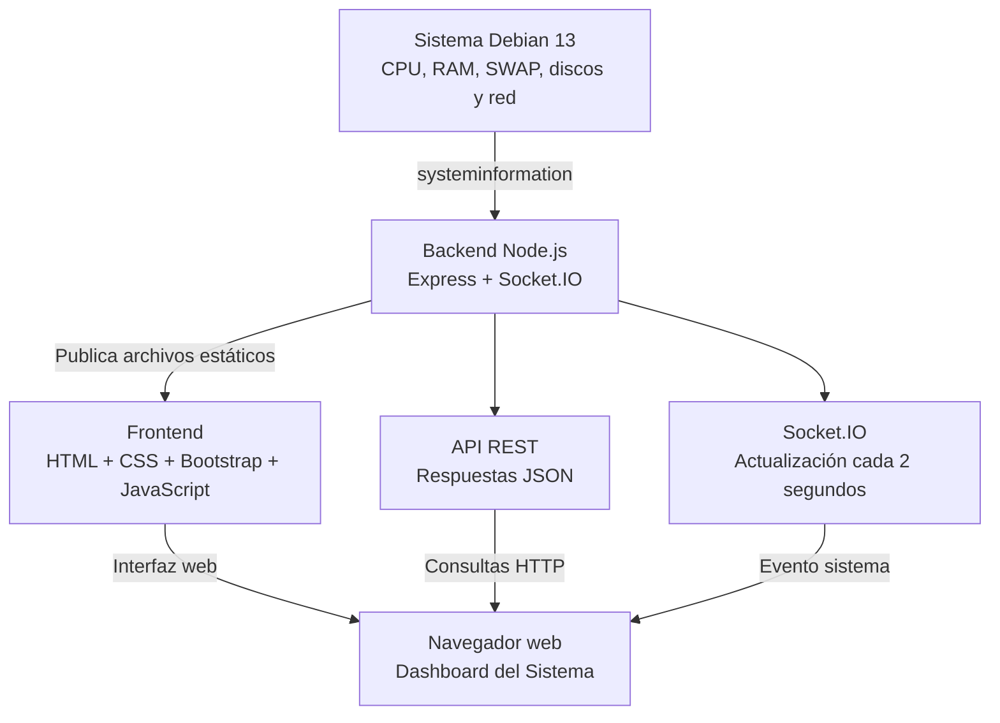

# Arquitectura del Monitor de Recursos GNU/Linux

## 1. Diagrama de arquitectura

El proyecto utiliza una arquitectura cliente-servidor.

El backend Node.js consulta los recursos de Debian 13
mediante la biblioteca systeminformation.

Express publica el frontend y proporciona una API REST.
Socket.IO transmite las métricas al navegador en tiempo real.

## 2. Entornos de ejecución

El proyecto se desarrolló colaborativamente mediante GitHub.

- Carolina desarrolló el backend en Debian 13,
  utilizando la dirección 192.168.100.40.
- Leonela desarrolló el frontend y verificó el sistema
  integrado en AUDITORIA, con dirección 192.168.3.5.

Cada backend obtiene los recursos del equipo Debian
donde se ejecuta.

La integración del código se realizó mediante Git,
sin requerir que las máquinas virtuales estén
conectadas a la misma red.
