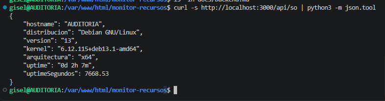
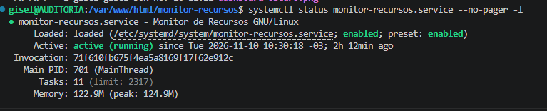

# Documentación del Backend
## Monitor de Recursos GNU/Linux

### 1. Descripción general

El backend del proyecto Monitor de Recursos GNU/Linux fue desarrollado por **Garcia Maria Carolina**, utilizando Node.js sobre una máquina virtual Debian 13.

Su función es obtener información del sistema operativo y los recursos del equipo, y transmitir esos datos al frontend mediante API REST y Socket.IO.

El proyecto utiliza una arquitectura cliente-servidor.

### 2. Tecnologías utilizadas

- **Node.js:** ejecución del servidor.
- **Express:** implementación del servidor web y las rutas API REST.
- **Socket.IO:** transmisión de información en tiempo real.
- **systeminformation:** consulta de recursos del sistema GNU/Linux.
- **CORS:** configuración de solicitudes entre distintos orígenes.
- **pnpm:** gestión de las dependencias.

Los archivos principales son `backend/server.js` y `backend/package.json`.

### 3. Entornos de desarrollo e integración

El trabajo se desarrolló colaborativamente utilizando dos máquinas virtuales Debian 13.

| Estudiante | Dirección IP | Responsabilidad |
|---|---|---|
| Garcia Maria Carolina | `192.168.100.40` | Desarrollo del backend |
| Leonela Gisel Vazquez | `192.168.3.5` | Desarrollo del frontend e integración en AUDITORIA |

Las estudiantes trabajan en redes diferentes.

Cada instalación del backend utiliza la biblioteca `systeminformation` para obtener los recursos de la máquina donde se está ejecutando.

Por lo tanto, cada servidor puede monitorear su propio sistema Debian de manera independiente.

La integración del código se realizó mediante Git y GitHub, reuniendo el backend y el frontend en un mismo repositorio.

### 4. Programación orientada a objetos

El backend implementa la clase `MonitorSistema`, que organiza las funciones de obtención de información.

Sus principales métodos son:

| Método | Descripción |
|---|---|
| `obtenerSO()` | Obtiene información del sistema operativo. |
| `obtenerCpu()` | Consulta el procesador, los núcleos y su utilización. |
| `obtenerMemoria()` | Obtiene información de RAM y SWAP. |
| `obtenerDiscos()` | Consulta las particiones y el espacio de almacenamiento. |
| `obtenerRed()` | Obtiene información de una interfaz de red. |
| `obtenerTodo()` | Agrupa las métricas en un objeto. |
| `leerConReintentos()` | Realiza hasta tres intentos para obtener los datos. |

También se utilizan funciones auxiliares para calcular porcentajes, convertir unidades y dar formato al tiempo de funcionamiento.

### 5. API REST

El backend utiliza Express y escucha conexiones HTTP en el puerto `3000`.

Se implementaron las siguientes rutas:

| Ruta | Información |
|---|---|
| `GET /api/sistema` | Información completa del sistema. |
| `GET /api/so` | Sistema operativo, arquitectura y tiempo de funcionamiento. |
| `GET /api/cpu` | Procesador, núcleos y uso de CPU. |
| `GET /api/memoria` | Memoria RAM y SWAP. |
| `GET /api/discos` | Discos y particiones. |
| `GET /api/red` | Información de la interfaz de red. |

Las respuestas se envían en formato JSON.

En el entorno de integración se utilizó:

`http://192.168.3.5:3000/api/sistema`

La dirección corresponde a la máquina virtual AUDITORIA y no al servidor original de Carolina.

### 6. Comunicación mediante Socket.IO

Socket.IO permite actualizar el dashboard sin recargar manualmente la página.

Cuando un cliente se conecta, el backend obtiene las métricas y envía la información mediante el evento `sistema`.

Posteriormente, el servidor realiza actualizaciones periódicas cada **2000 milisegundos**, equivalentes a 2 segundos.

Si ocurre un problema durante la lectura, puede enviar el evento `error-monitor`.

El código evita ejecutar lecturas periódicas superpuestas mediante la variable `leyendo` y omite esas lecturas cuando no hay clientes conectados.

### 7. Estructuras de programación utilizadas

El backend incluye contenidos trabajados durante la cursada:

- Variables y constantes.
- Funciones.
- Objetos literales y arreglos.
- Condicionales `if/else`.
- Estructuras repetitivas `for` y `do/while`.
- Manejo de errores mediante `try/catch`.
- Programación orientada a objetos.
- Operaciones asíncronas mediante `async/await`.
- Intercambio de datos JSON.

### 8. Manejo de errores

El código utiliza estructuras `try/catch` para controlar problemas durante las consultas.

El método `leerConReintentos()` permite realizar hasta tres intentos cuando no se obtienen los datos correctamente.

Las rutas API devuelven respuestas HTTP con código `500` cuando ocurre un error de procesamiento.

### 9. Integración con el frontend

El servidor Express publica los archivos de `frontend/public`.

El frontend fue desarrollado con HTML, CSS, Bootstrap y JavaScript, y muestra seis secciones de monitoreo:

1. Procesador (CPU).
2. Memoria RAM.
3. Almacenamiento.
4. Interfaces de red.
5. Sistema operativo.
6. Memoria SWAP.

Los valores se actualizan utilizando la información recibida desde el backend.

### 10. Verificaciones realizadas

En la máquina de integración `AUDITORIA` se comprobó el funcionamiento del servidor Node.js, las rutas API REST y la conexión del dashboard.

También se verificó que los valores mostrados correspondieran al sistema monitoreado.

Mediante la solicitud:

`curl -s http://localhost:3000/api/so`

se obtuvo el campo:

`"hostname":"AUDITORIA"`

Esto confirmó que el backend integrado estaba consultando los recursos de la máquina virtual AUDITORIA.

Se verificó además la memoria RAM y SWAP utilizando el comando `free -h`.

### 11. Ejecución como servicio

El proyecto dispone de un servicio systemd denominado `monitor-recursos`, utilizado para ejecutar el backend Node.js.

Esta configuración permite administrar el proceso desde Debian utilizando `systemctl`.

### 12. Evidencias

Se incorporarán capturas que permitan verificar:

- Las respuestas de las rutas API REST.
- El estado del servicio Node.js.
- La comunicación con el frontend.
- La obtención de métricas reales de Debian 13.

Las evidencias se almacenarán en `docs/capturas/`.

### 12.1. Verificación de la API REST del sistema operativo

Se realizó una consulta a la ruta `/api/so` del servidor
Node.js desde la terminal de Debian 13.

Comando utilizado:

```bash
curl -s http://localhost:3000/api/so | python3 -m json.tool
```

La API respondió correctamente mediante un objeto JSON
que contiene el nombre del equipo, la distribución,
la versión del sistema operativo, el kernel,
la arquitectura y el tiempo de funcionamiento.

El resultado mostró el hostname `AUDITORIA`, confirmando
que el backend integrado obtiene información real de
la máquina virtual donde está ejecutándose.

**Figura 1. Respuesta de la API REST `/api/so`.**



### 12.2. Verificación del servicio systemd

Se verificó el estado del servicio `monitor-recursos.service`,
encargado de ejecutar el backend Node.js en Debian 13.

Comando utilizado:

`systemctl status monitor-recursos.service --no-pager -l`

El resultado mostró que el servicio se encuentra habilitado
(`enabled`) y en ejecución (`active (running)`).

Esto confirma que el servidor Node.js está funcionando como
un servicio administrado por systemd y configurado para
iniciarse automáticamente con el sistema.

**Figura 2. Estado del servicio monitor-recursos en Debian 13.**


