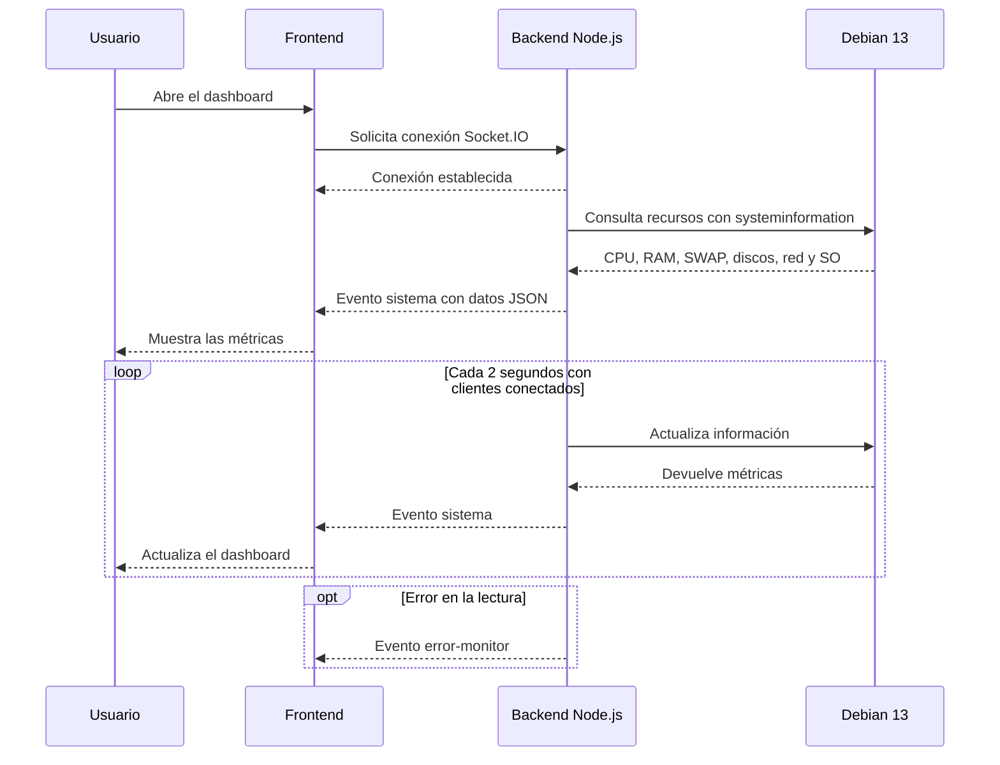

# Comunicación en tiempo real con Socket.IO

## 1. Descripción

El Monitor de Recursos GNU/Linux utiliza Socket.IO
para mantener una comunicación entre el frontend
y el backend Node.js.

Cuando un navegador se conecta, el backend consulta
los recursos de Debian 13 mediante systeminformation
y envía las métricas al cliente.

Mientras existan clientes conectados, se realizan
actualizaciones periódicas cada 2 segundos.

## 2. Diagrama de secuencia

## 3. Funcionamiento

1. El usuario abre el dashboard desde el navegador.
2. El frontend establece una conexión Socket.IO.
3. El backend obtiene las métricas de Debian.
4. Los datos se transmiten mediante el evento `sistema`.
5. JavaScript actualiza las tarjetas del dashboard.
6. El backend realiza nuevas lecturas cada 2 segundos
   mientras haya clientes conectados.
7. Si ocurre un problema de lectura, el servidor
   puede enviar el evento `error-monitor`.

## 4. API REST

Además de Socket.IO, el backend dispone de rutas
HTTP que permiten consultar las métricas mediante JSON.

Entre ellas se encuentran:

- /api/sistema
- /api/so
- /api/cpu
- /api/memoria
- /api/discos
- /api/red

Estas rutas permiten consultar recursos individuales
o la información completa del equipo.

## 5. Integración

Carolina desarrolló el backend y Leonela el frontend.

Ambas partes se integraron en un mismo proyecto
mediante Git y GitHub.

El funcionamiento del sistema integrado fue verificado
en la máquina virtual Debian 13 AUDITORIA.
