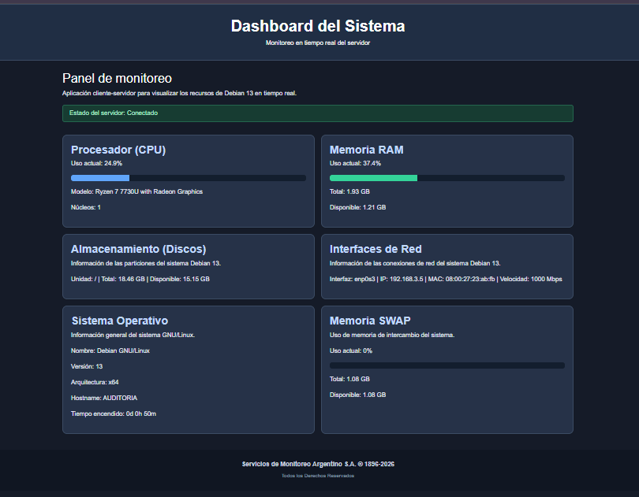

# Documentación del Frontend

## 1. Descripción

El frontend del proyecto Monitor de Recursos GNU/Linux
permite visualizar información del sistema Debian 13
mediante un dashboard web.

La interfaz muestra métricas obtenidas desde el backend
Node.js, utilizando Socket.IO para recibir actualizaciones
en tiempo real.

## 2. Tecnologías utilizadas

- HTML5: estructura de la página.
- CSS3: diseño y personalización visual.
- Bootstrap 5: distribución de tarjetas y adaptación a pantallas.
- JavaScript: actualización de los elementos del dashboard.
- Socket.IO: comunicación en tiempo real con el servidor.

## 3. Estructura del frontend

Los archivos principales son:

- frontend/public/index.html
- frontend/public/css/estilos.css
- frontend/public/js/app.js

## 4. Funcionalidades

El dashboard contiene seis tarjetas:

1. Procesador (CPU): porcentaje de uso, modelo y núcleos.
2. Memoria RAM: uso, capacidad total y memoria disponible.
3. Almacenamiento: capacidad y espacio disponible en discos.
4. Interfaces de red: interfaz, dirección IP, MAC y velocidad.
5. Sistema operativo: distribución, versión, arquitectura,
   hostname y tiempo de funcionamiento.
6. Memoria SWAP: porcentaje utilizado, capacidad total
   y espacio disponible.

También muestra el estado de conexión con el servidor.

## 5. Diseño visual

Se implementó un tema oscuro.

Características:

- Fondo general oscuro.
- Encabezado azul grisáceo.
- Tarjetas oscuras con títulos celestes.
- Textos claros para mejorar la lectura.
- Barras de progreso diferenciadas por colores.
- Distribución adaptable mediante Bootstrap.
- Pie de página personalizado.

Los cambios visuales se realizaron en HTML y CSS,
conservando los identificadores utilizados por JavaScript.

## 6. Comunicación con el backend

El frontend se comunica con el servidor Node.js.

Socket.IO permite recibir datos y actualizar las métricas
sin recargar manualmente la página.

La aplicación se consulta en el laboratorio mediante:

http://192.168.3.5:3000/

La dirección corresponde a la red local utilizada
durante las pruebas.

## 7. Verificación realizada

Se abrió el dashboard desde el navegador y se comprobó:

- Estado del servidor: Conectado.
- Visualización de las seis tarjetas.
- Presentación de datos reales de Debian 13.
- Barras de progreso para CPU, RAM y SWAP.
- Aplicación correcta del tema oscuro.

Se verificaron los valores de memoria mediante el
comando free -h en Debian.

## 8. Evidencia

Se registró una captura del dashboard con el tema
oscuro y el servidor conectado.

La captura se incorporará a la documentación del proyecto.

### Captura del dashboard final

La siguiente imagen muestra el Monitoreo en tiempo real del servidor.

Se observa la conexión activa con el servidor Node.js y
las seis tarjetas con información del sistema Debian 13.

